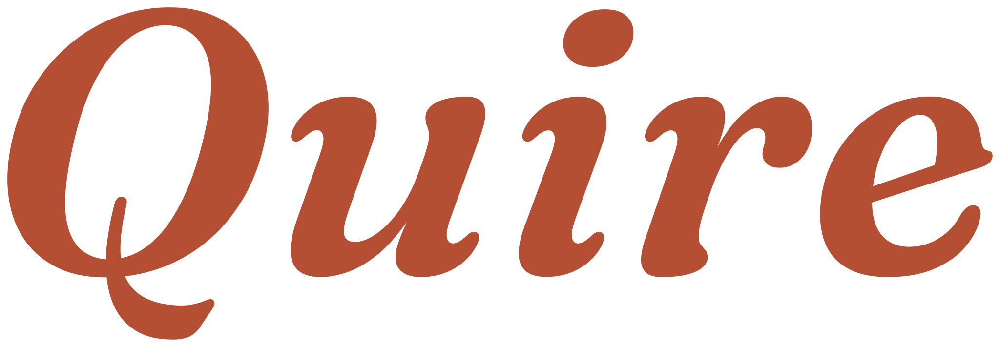
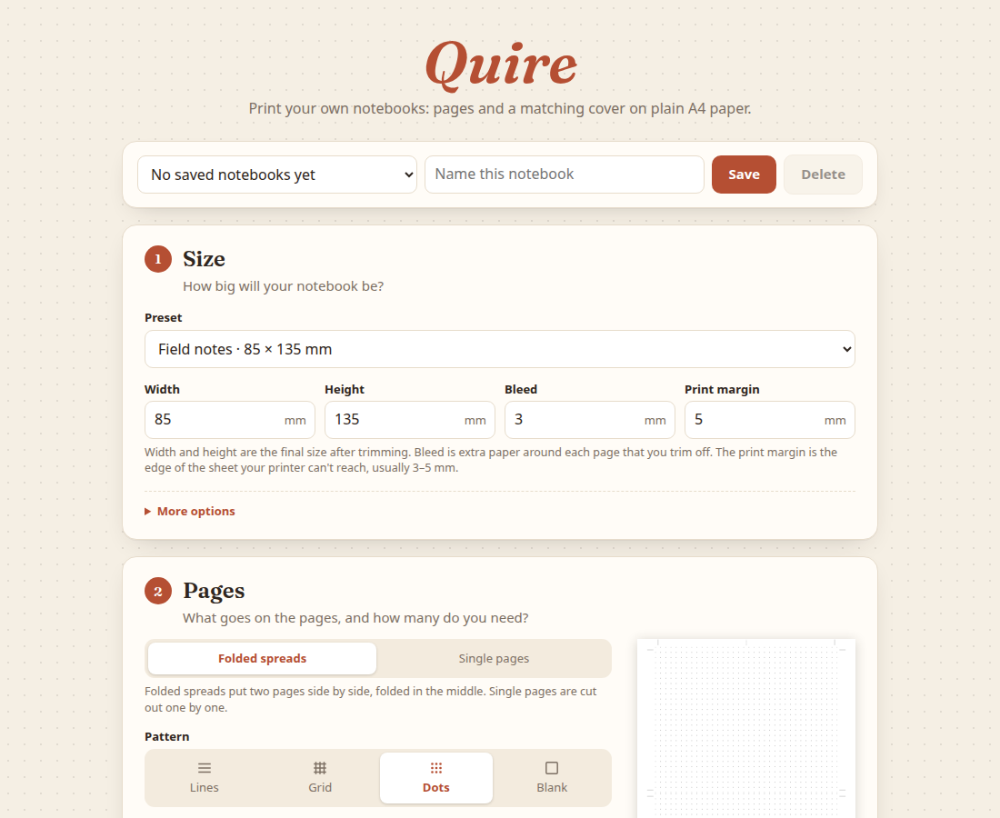

**Print your own notebooks: pages and a matching cover on plain A4 paper.**

 

Quire is a small, self-contained web page. Pick a size and a page pattern, place a cover image, and print everything from the browser or save it as a PDF. There's no login, no backend and no build step.

## Features

- **Any notebook size:** presets (A6, B6, Pocket, Field notes) or a custom size, with bleed.
- **As many pages per A4 sheet as fit:** Quire calculates the layout and rotates pages when more fit that way.
- **Folded spreads or single pages:** spreads print two pages side by side with fold marks. Single pages are cut out one by one.
- **Patterns:** lines, grid, dots or blank, with adjustable spacing, color and line or dot size. For double-sided printing the pattern is centered, so front and back line up.
- **Cover with spine:** upload an image or paste an image or Pinterest URL, then drag, zoom, rotate and mirror it into place. Back, front and spine are marked. The spine width is calculated from the number of sheets and the paper thickness. If it fits, the cover can be printed in the same direction as the pages, so it folds along the same paper grain.
- **Text on the cover:** add titles to the front, spine or back, with the fonts installed on your device, and move them freely or snap them to the middle.
- **Crop and fold marks** on both pages and cover.
- **Printer calibration:** print a test sheet, enter what you read from it, and Quire corrects the size, the print margin and the front to back alignment for your printer.
- **Saved notebooks:** save settings, including the cover image, and restore them later from a dropdown.

## Printing

In the browser's print dialog:

- Set scale to **100 % / Actual size**. "Fit to page" shrinks everything by a few percent.
- Set margins to **None** and turn headers and footers off.
- For double-sided printing, flip on the long edge.

To match Quire to your printer, use **Calibrate printer** in the print section and follow the steps there. A PDF saved afterwards includes the correction, so print it on that printer.

If you save a PDF and print it later, print it at "Actual size" from your PDF viewer too. To check the result, measure the distance between the crop marks. It should match your notebook's width and height exactly.

Pinterest often blocks direct access to pins. If loading a pin link fails, open the pin, right-click the image, choose "Copy image address" and paste that `i.pinimg.com` address instead.

## Privacy

Everything runs in your browser. Settings, printer calibration and saved notebooks, including cover images, are stored only in your browser on this device (localStorage and IndexedDB).

The one exception is pasting a Pinterest pin link. To find the image, Quire asks Pinterest and, if that fails, the public proxy `api.allorigins.win`. Direct image addresses and uploaded images never leave your browser.

## Development

Plain HTML, CSS and JavaScript. Open `index.html` in a browser or serve the folder with any static file server. Chrome and Edge work best for printing.

`how-it-works.html` (tutorial) and `privacy.html` are plain pages that only share `style.css`.

The scripts are loaded in this order and share their globals:

- `state.js`: settings, storage and small helpers
- `calibration.js`: printer calibration, test sheet and its dialog
- `sheets.js`: layout and HTML of the printed sheets
- `text.js`: cover text and its editing
- `app.js`: the page itself with previews, inputs, cover editing, saved notebooks and printing

The site runs at [quirelet.de](https://quirelet.de) as static files on an nginx server. Canonical links and share images in the HTML files use that address.

## License

[MIT](LICENSE). The bundled Fraunces font is licensed under the [SIL Open Font License](fonts/OFL.txt).
